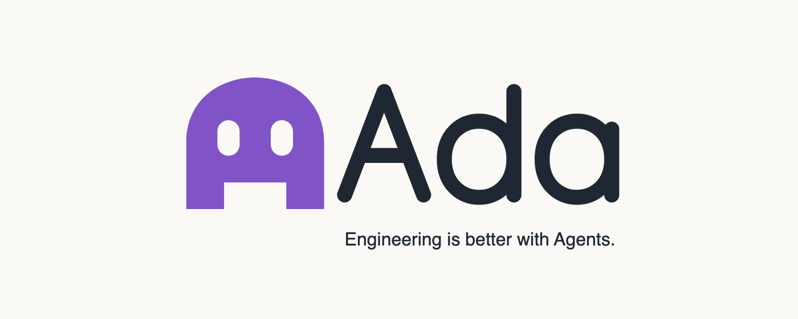

<p align="center">
  <picture>
    <source media="(prefers-color-scheme: dark)" srcset="assets/agents/pip-lockup-dark.png">
    <source media="(prefers-color-scheme: light)" srcset="assets/agents/pip-lockup-light.png">
    
  </picture>
</p>

<p align="center">
  <a href="https://x.com/jayleaton"></a> <a href="https://buymeacoffee.com/jayleaton"></a>
</p>

Ada (Agentic Desktop Application) lets you direct the coding agents on your machine (Claude Code, Codex, Cursor, Grok Build,
OpenCode, Google Antigravity, and fx) from one workspace, across a desktop app, a web app, and a
mobile app. Your agents run wherever Ada runs: your desktop, a server, or a VPS, and you can connect
to it from anywhere.

## Grant's fork

This is Grant Charge's copy of Ada. It comes from
[jayleaton/ada](https://github.com/jayleaton/ada). Jayj Eaton makes Ada.
Grant adds a small number of changes on top of it.

### What Grant added

**1. Warnings for risky commands**

- Sometimes an agent asks you to approve a command.
- If the command can delete or destroy work, the app shows a red warning.
- The warning tells you what the command does.
- Examples: delete many files, force push, or delete a database.
- You see the warning only in Supervised mode. In Full access mode, the agent does not ask.

**2. A warning for a cold prompt cache**

- Claude keeps your chat in a fast memory for a short time. This memory is the prompt cache.
- On a subscription, this time is 1 hour. With an API key, it is 5 minutes.
- After that time, your next message is slower and costs more.
- A Claude chat can have more than 100,000 tokens. Then a banner tells you when the cache is cold.
- The banner has a "Compact first" button. You can also close the banner.

**3. Plain technical English replies**

- Agents reply in short, clear sentences. This is the default.
- The style follows ASD-STE100 (Simplified Technical English).
- To stop it, go to Settings → Threads → "Plain technical English replies".

**4. The rewrite button (wand)**

- The wand button is next to the paperclip.
- Click it to make your draft short and clear before you send it.
- Code, file paths, names and @mentions do not change.
- To get your old text back, click Undo. Undo stays on the screen for 30 seconds.
- The button uses the text model in Settings. Grant uses OpenCode with DeepSeek V4.1 Flash.

**5. Jayj's newest changes**

- On 7 November 2026, the fork got 772 changes from jayleaton/ada.

### How the fork stays up to date

The fork updates itself. A GitHub workflow does these steps
([grant-upstream-sync.yml](.github/workflows/grant-upstream-sync.yml)):

1. Every 6 hours, it looks for Jayj's newest nightly release.
2. If the fork has that release, it stops.
3. If not, it merges the release into `main`.
4. Then it runs Jayj's checks and Grant's tests.
5. If all checks pass, it pushes the merge to `main`.
6. If the merge has a conflict, or a check fails, it opens a pull request. A person or an agent must
   fix the problem.

When `main` changes, a second workflow makes a new release
([grant-release.yml](.github/workflows/grant-release.yml)):

1. It builds a Mac app (Apple silicon) and a Linux app (AppImage).
2. It puts them on this fork's [Releases page](https://github.com/GrantCharge/ada/releases).

The sync workflow needs a secret with the name `FORK_SYNC_TOKEN`. This is a GitHub token. It must
have permission to write code, pull requests and workflows. The built-in GitHub token cannot do this.

### How to update your apps

**Linux server**

- A timer starts `t3-headless-update` each day at 04:30 (Bangkok time).
- The script gets the newest release from this fork and installs it.
- If the new version does not start, the script goes back to the old version.

**Mac**

- Apple did not sign this app. Because of this, the app cannot install updates itself.
- The app tells you when an update is ready. Then do these steps:
  1. Get the `.dmg` file from the [Releases page](https://github.com/GrantCharge/ada/releases).
  2. Quit T3 Agents.
  3. Open the `.dmg` file. Drag the app into Applications.

**After an update**

- Sometimes OpenCode shows no models after the server starts again.
- Wait 5 minutes. Or go to Settings → Providers and click Refresh.

### Rules for this fork

- Grant's changes go only to this fork. They do not go to jayleaton/ada or pingdotgg/t3code.
- Do not change Jayj's `fork-*` workflows. They run only on his repository. If you change them,
  you get merge conflicts.


## Installation

> [!WARNING]
> Ada currently supports Codex, Claude, Cursor, Grok Build, OpenCode, Antigravity, and fx. Install and authenticate at least one provider before use:
>
> - Codex: install [Codex CLI](https://developers.openai.com/codex/cli) and run `codex login`
> - Claude: install [Claude Code](https://claude.com/product/claude-code) and run `claude auth login`
> - Cursor: install [Cursor CLI](https://cursor.com/cli) and run `agent login`
> - Grok Build: install [Grok Build CLI](https://x.ai/cli) and run `grok login`
> - OpenCode: install [OpenCode](https://opencode.ai) and run `opencode auth login`
> - Antigravity: enable it in Settings, then use **Install Antigravity** and **Sign in with Google**. No CLI is required.
> - fx: install [fx](https://fx.sh) and run `fx login` on the machine running the Ada server ([setup guide](./docs/user/providers-fx.md))

### Desktop app

Download Ada from [GitHub Releases](https://github.com/jayleaton/ada/releases): the `.dmg` on macOS, the `.exe` on Windows, or the `.AppImage` or `.deb` on Linux. Its updater then follows nightly releases; there is no Stable track yet.

`winget`, Homebrew, the AUR, Nix and `npx t3` install T3 Code, not Ada.

### Command line

The desktop app includes the `ada` command (**Settings → About → ada command**). `ada update` and `ada service install` download Ada's releases. For a Linux machine without a desktop, see [Headless Linux host](./docs/operations/headless-linux.md).

### Switching from T3 Code

Ada uses the same data directory (`~/.t3`), so your projects, threads, settings, provider sign-ins and paired devices carry over, and phones and other machines still recognise this one. Your database is upgraded the first time Ada starts.

- Quit T3 Code first. The two apps share one profile, so only one of them can run at a time.
- If you installed T3 Code's background service, run `t3 service uninstall` before opening Ada. Otherwise that service keeps using your data directory and Ada cannot start its own server.
- Ada does not include T3 Connect. Devices you paired through T3 Connect need to pair again over your local network or tailnet ([remote access](./docs/user/remote-access.md)).

## Some notes

We are very very early in this project. Expect bugs.

We are (mostly) not accepting contributions yet. Small fixes may be considered. Big features will not be.

## Documentation

Full docs live in [docs/](./docs). There's no docs site yet.

- [FAQ](./docs/user/faq.md)
- [Install and first run](./docs/user/install.md)
- [Permission modes](./docs/user/permission-modes.md)
- [Keyboard shortcuts](./docs/user/keybindings.md)
- [Project settings](./docs/user/project-settings.md)
- [Appearance preferences](./docs/user/appearance.md)
- [Remote access from a phone or another machine](./docs/user/remote-access.md)
- [Connect Claude Code, Codex, ChatGPT and other agents over MCP](./docs/user/outside-agents.md)
- [Keeping app and server in sync](./docs/user/updating.md)
- [Source control integrations](./docs/user/source-control.md)
- Multiple accounts: [Codex](./docs/user/providers-codex.md) · [Claude](./docs/user/providers-claude.md)
- [Run Ada as a background service](./docs/user/background-service.md)

Building from source? Start at [docs/internals/overview.md](./docs/internals/overview.md).

## If you REALLY want to contribute still.... read this first

### Install `vp`

Ada uses Vite+ so you'll need to install the global `vp` command-line tool.

#### macOS / Linux

```bash
curl -fsSL https://vite.plus | bash
```

#### Windows

```bash
irm https://vite.plus/ps1 | iex
```

Checkout their getting started guide for more information: https://viteplus.dev/guide/

### Install dependencies

```bash
vp i
```

Read [CONTRIBUTING.md](./CONTRIBUTING.md) before reporting a bug or opening a PR.

Have a feature request? Start a [discussion](https://github.com/jayleaton/ada/discussions).

Found a bug? Open an [issue](https://github.com/jayleaton/ada/issues).
